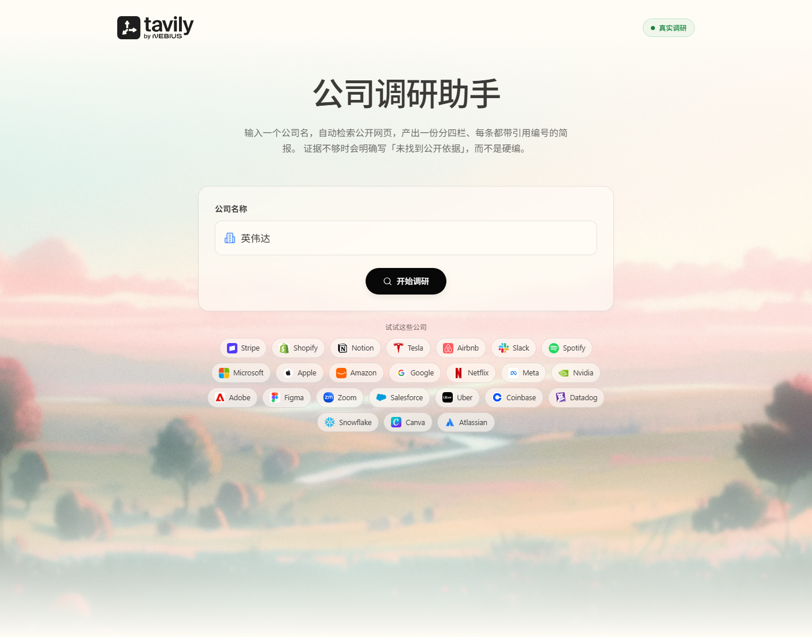

# 企业调研简报系统 / Company Research Briefing

**v1.0.0** — 基于 LangGraph 的公司调研工作流：证据充分性判定、有界自纠正、栏目级拒答、
可插拔人工复核，以及历史结果复用。

> **二次开发声明 / Attribution**
> 本仓库**基于** [guy-hartstein/company-research-agent](https://github.com/guy-hartstein/company-research-agent)（Apache-2.0）**二次开发**，落地 commit `23fe92d`。原版的四路并行检索、Tavily 相关性筛选、PDF 导出、SSE 进度与多语言 README **均不是本项目的独立设计**；`LICENSE` 与上游 commit 历史完整保留。详见 [`docs/UPSTREAM.md`](docs/UPSTREAM.md)。
>
> **What this fork adds**: a LangGraph state workflow with evidence-sufficiency checks, a bounded self-correction loop, per-section abstention instead of fabrication, reducer-based parallel writes and real SQLite checkpointing (`graph/`, `capabilities/`, `persistence/`, `config/`, `tests/`). Design and measured baseline: [`docs/PROJECT_PLAN.md`](docs/PROJECT_PLAN.md), [`docs/BASELINE.md`](docs/BASELINE.md).
>
> **Current status — read before running**: the new graph runs in `fixture` mode on synthetic data and needs no API key (`uv run python -m graph.run --case sparse --show-report`). Since S5-B both **FastAPI `/research` and the LangGraph Studio entry point to the new graph**; `/research` currently consumes only `company`. In `fixture` mode `briefing` uses a local deterministic mock backend; in `live` mode it uses a real `with_structured_output` LCEL chain. **Real measurements so far: 4 Tavily searches / 8 credits, 5 `qwen-plus` requests, 1 full end-to-end report (Notion, 4998 chars).** See `docs/LIVE_FINDINGS.md` — that report also contains a **real contradiction** (both "founded in 2013" and "founded in 2014"), so **no accuracy figure is claimed**. Real retrieval stays behind a three-way opt-in (`APP_MODE=live` + `TAVILY_LIVE_ENABLED=true` + `TAVILY_MAX_CALLS>0`), a hard per-run call budget and a disk cache. The human-verified golden set is still a draft awaiting review (`evals/golden_live_draft.jsonl`, aided by `evals/golden_live_review.jsonl`).

An agentic research tool that turns a company name into a structured, source-backed briefing. The FastAPI backend coordinates specialized research and synthesis steps; the React interface tracks the job and lets you export the finished report as a PDF.



## What it does

- Researches a company’s business, industry, financial context, and recent news.
- Uses Tavily search and relevance scoring to find and curate source material.
- The frontend is now a single-field form (company name + a row of example chips). The model is
  chosen **on the server** with `LLM_PROVIDER` / `LLM_MODEL`; there is no in-browser model picker or
  key input, because `/research` only reads `company` from the request body.
- Streams research progress to the browser and supports PDF export.
- Persists jobs, reports and the underlying evidence in Postgres (upstream used MongoDB; replaced by
  `persistence/job_store.py`), so past results survive restarts and can be reused.
- **This fork also adds** a LangGraph workflow (`graph/`) with evidence-sufficiency checks, a bounded self-correction loop, per-section abstention instead of fabrication, structured output with URL-level traceability, and SQLite checkpointing. It runs today from the CLI, `/research` and LangGraph Studio in `fixture` mode with no API key and zero external calls.

## Architecture

Two graphs live in this repository. Since S5-B, **both public entry points (`application.py` → `/research`, and `langgraph_entry.py` → Studio) compile the reworked `graph/`**; the upstream linear DAG is kept only as an untouched reference. All entry points currently run `fixture` mode; live retrieval is explicitly disabled by default.

### Upstream — unchanged (reference only, no longer wired to the entry points)

```text
React + Vite UI → POST /research → FastAPI application → Research graph
  analyzers → collector → curator → briefing → editor
  Tavily search + relevance scoring · OpenRouter / OpenAI / Gemini · PDF export · SSE progress
```

The UI connects to the API with `VITE_API_URL` and receives incremental updates from `GET /research/{job_id}/stream`.

### This fork — `graph/` (5-node main graph + four section subgraphs with distinct topologies)

```text
START → grounding → [orchestrator subgraph] → briefing → END
                                                   ↑
                                     (human_review when FEATURES_HUMAN_REVIEW)

orchestrator subgraph:  START → orchestrator ──Send──→ company   ┐
                                              ──Send──→ industry  ├→ arbitrate → END
                                              ──Send──→ financial │
                                              ──Send──→ news      ┘

each section owns its OWN topology (not one template × 4):
  company    retrieve → guard → extract → judge → conflict → write
  financial  retrieve → guard → bind_subject → extract → verify_amount → judge → timeline → write
  news       retrieve → guard → filter_entity → extract → judge → freshness → write
  industry   retrieve → guard → extract → judge → scan → fetch → extract2 → matrix → write
  (judge sends the flow back to `retrieve` in all four; bounded by max_retry)
```

Why they differ — each extra stage is forced by the task, not by decoration:

- **company** stays linear: it reads static attributes of one entity, so one search round is
  usually enough. Its only extra stage is same-round conflict annotation (a live run found
  three different founded years: 2012 / 2014 / 2016, while the truth is 2013).
- **financial** binds the subject *before* extracting: money errors look like facts, so it
  first decides listed / not_listed / unknown and which ticker applies. Otherwise
  `Notion VTec Berhad (0083.KL)` (a Malaysian listed company) is read as Notion's accounts.
  `verify_amount` then checks every amount against the source text with pure rules.
- **news** filters by **semantics, not literals**: `Notion Labs, Inc.` *is* Notion, while
  `Notion Consulting` (bought by Sia Partners) has no listing-page fingerprint at all, so any
  string rule either misses it or kills real hits. One batched LLM call returns
  same / different / uncertain; `uncertain` is kept and flagged, never deleted.
- **industry** is the only two-round section: the first query is about the target company and
  cannot return competitors' own facts. Round two turns the scanned name list into one query
  per competitor (`graph.competitor_fetch` gates the extra spend) and re-extracts only the new
  documents.

What is shared is the **primitives** (`graph/agents/primitives.py`: retrieve / guard / extract
/ judge / analyze / write as node factories), not the flow. Sections can only differ in
topology because nothing upstream decides their order.

- `Send` fans out four **independently compiled** subgraphs in parallel; each owns its state
  schema, so reducer-backed writes never overwrite each other. They are also **topologically
  different** — `tests/test_r7_topology.py` fails if anyone flattens them back into one shared
  pipeline (that is exactly what R3 did, and it made all four workflows identical).
- Sufficiency is judged **inside each subgraph**: when a section has fewer than
  `min_docs_per_section` facts it re-searches itself (bounded by `max_retry`, 2) and otherwise
  ends in an explicit "no public evidence found" abstention. The old main-graph retry loop is
  gone — `curate` / `evidence_check` / `rewrite_query` / `degrade` were removed in R3, and
  query rewriting, relevance filtering and entity disambiguation now live in the subgraphs.
- Extraction runs a **three-level fallback chain** (`graph/agents/extract.py`): real LLM →
  local-model slot (reserved, currently empty) → deterministic rules. Each section injects its
  own prompt addendum; the chain is shared so a future local model plugs in at one place.
- `briefing` is a **pure assembler** (`graph/nodes/assemble.py`): it collects the four
  paragraphs, assigns `[n]` numbering once and emits References. Sections never allocate
  numbers, so cross-section collisions cannot happen.
- **R4 per-section analysis**, behind `FEATURES_POSTPROCESS=true`: same-round conflict
  annotation, financing timeline + money-fidelity (amount must appear in the source text),
  competitor detection + verbatim comparison matrix, news freshness + event grouping. It is
  rendered as `>` quote blocks only — fact bullets and References stay byte-identical, so the
  baseline does not drift. With the switch off (default) the report is unchanged.
- Every step is persisted by a checkpointer (`persistence/checkpointer.py`: SQLite by default,
  Postgres via `AsyncPostgresSaver`) and survives a restart.
- `features.structured_output` is now a **legacy switch**: extraction moved into the subgraphs
  in R3, so the report layer no longer branches on it. The A/B group `free_text_output`
  therefore reports `no_effect` — stated explicitly rather than presented as a measured gain.
- The data source is an `@tool`-wrapped fixture by default (`capabilities/retrieval.py`). `live` mode adds `TavilyRetriever(BaseRetriever)` plus a call budget, disk cache and dry-run; it is **disabled by default** even when a key is installed.
- **S6 HITL** is opt-in: with `FEATURES_HUMAN_REVIEW=true` and `AUTO_APPROVE_REVIEW=false`, an extra `human_review` node calls `interrupt()` before `briefing` and the run pauses. A second CLI process resumes it from the SQLite checkpoint with `Command(resume=...)`. A reviewer can approve, reject the whole report, or reject selected sections — rejected sections abstain instead of inventing content. Default `FEATURES_HUMAN_REVIEW=false` keeps the main graph at exactly 5 nodes.

```bash
uv run python -m graph.run --case sparse --show-report --trace
# A/B: FEATURES_STRUCTURED_OUTPUT=false uv run python -m graph.run --case sparse --trace
# live 检索需显式放行：APP_MODE=live TAVILY_LIVE_ENABLED=true TAVILY_MAX_CALLS=1
# 先看会发哪些 query（0 次真实请求）：TAVILY_DRY_RUN=true ...

# S6 人工复核（两步，两个独立进程，共用同一个 db）
uv run python -m graph.run --case sparse --review --db ./data/review.db
uv run python -m graph.run --resume --case sparse --db ./data/review.db \
  --decision reject-sections --reject-sections news --show-report
```

## Evaluation (S7)

One command runs the whole eval suite in `fixture` mode and writes `evals/scorecard.json`:

```bash
uv run python -m evals.run_eval                 # 6 A/B groups x 3 cases, 18 real graph runs
uv run python -m evals.build_golden --check    # CI: golden set in sync with fixture/settings
uv run python -m evals.run_eval --compare evals/scorecard.json --output evals/scorecard.next.json
```

`.github/workflows/eval.yml` runs `pytest` + the scorecard + a regression gate against the committed baseline; regressions beyond `0.02` fail the build and print the degraded golden item ids (e.g. `sparse:company:2`).

> **Read this before quoting any number.** The golden set is **derived from the synthetic fixture corpus** (`provenance: synthetic-fixture-derived`), not from real company facts. A baseline score of `1.000` means "the system reproduces the given documents with correct citations under the configured rules" — a **contract-regression test**, not model accuracy. `citation_traceability` here is a lexical-containment proxy, not semantic entailment; `cost_per_report` is `0.0` because there are zero external calls. The planned 30–50 human-verified companies require real retrieval + keys and belong to a later live-measurement stage. None of these numbers should be presented as real-world accuracy in a résumé.

`no_inline_citations` is a deliberately broken **negative control** (inline citations switched off): it scores `citation_traceability=0.0` / `hallucination_rate=1.0` on purpose, so a future change that removes citations shows up in the scorecard immediately. That `1.0` is not a measured hallucination rate of the default configuration.

The evaluator refuses to start unless `APP_MODE=fixture` and installs a non-loopback `socket.connect` guard while running, so it cannot consume Tavily or LLM quota even if configuration is changed by mistake. Measured: `tavily=0, llm=0, blocked_connection_attempts=0`.

## Live readiness and first real call (S8.0–S8.2)

`S8.0` is a read-only audit and `S8.1` is a **0-request dry-run** of the full graph:

```bash
uv run python -m evals.live_dryrun     # -> evals/live_dryrun.json
```

It needs **no API key and no quota**: `TAVILY_DRY_RUN=true` is an isolated path that forces a sentinel client (never constructs `AsyncTavilyClient`), records the 12 queries a full run would issue together with their sha256 cache keys, and proves `calls_made=0` with a socket guard plus credential-usage counters. See `docs/LIVE_READINESS.md` for the audit (including the `/models` egress risk and the SDK signature check).

Tavily's published pricing is **1 credit per `basic` search / 2 credits per `advanced` search** (1000 free credits/month). This project defaults to `advanced`, so one full research run is at worst 12 requests ≈ **24 credits per company** without cache — an estimate, not a measured charge.

**S8.2 (approved, 2 credits)**: `evals/live_probe.py` made **exactly one** real `advanced` search through the production retrieval path, hard-capped by `CallBudget(1)` and a `RecordingClient` that blocks a second SDK invocation. Result: `response["results"]` assumption confirmed, 3 results with `url/title/content/score` present (plus `id`, `raw_content`), scores `0.717–0.815`, content `794–2011` chars, `documents_from_results` produced 3 Documents. `evals/live_probe.json` contains **structure only** — no body text, no full URLs, no keys. The real response is cached under the gitignored `evals/cache/tavily/`, so the same query reproduces offline at **0 further credits**. At that stage there were **0 model calls** and **no accuracy/latency/cost claim**.

**S8.3 (approved, 6 more credits)**: `evals/llm_probe.py` verified that `qwen-plus` honours
`with_structured_output(function_calling)` (1 request / 748 tokens). `evals/live_run.py` then ran
**one full end-to-end real report** for Notion: 3 real searches + 1 cache hit = **6 credits**
(cumulative **8 / 50**), 4 model requests / 7896 tokens, 62.9 s, 4998-char report with all four
sections and 11 references. `evals/live_quality.py` (0 calls) found a **real contradiction** —
the same `Company Overview` states both "founded in 2013" and "founded in 2014" — plus a London
headquarters claim that conflicts with the official one. Citation *integrity* held (every `[n]`
maps to a reference); fact *correctness* did not. Full numbers and honest boundaries:
`docs/LIVE_FINDINGS.md`. **No accuracy figure is claimed.**

Model provider for live mode is Alibaba Cloud DashScope via its OpenAI-compatible endpoint (`LLM_PROVIDER=dashscope`, `LLM_MODEL=qwen-plus`, `LLM_BASE_URL=https://dashscope.aliyuncs.com/compatible-mode/v1`). Keys stay in OS user variables and are mapped into the process only when a live run is explicitly invoked; see `.env.example`.

## Prerequisites

The reworked graph and all entry points need **no API key** in `fixture` mode.
The UI no longer asks for one either: the Tavily-key box, the URL / HQ / industry fields and the
model picker were removed in **S13**, because `/research` reads credentials from the environment
and consumes exactly one field (`company`). What is left is: company name → run → report.

`GET /config` reads process environment variables; the UI uses it only to show which mode the
server is in (**真实调研** vs **演示数据**) and to warn when a live server has no key.
**`GET /models` still proxies OpenRouter's public model list** and nothing in the UI calls it any
more — the route is kept because upstream endpoints are left untouched (plan §9.4). The claim
"zero external calls" applies to the reworked graph, `/research` and the Studio entry only —
verified by socket-level guards in `tests/test_s5_offline.py`.

- Python 3.11 (`.python-version`; the reworked graph and its tests are pinned to 3.11)
- Node.js 18 or later — only for the upstream React UI
- `TAVILY_API_KEY` — **optional, and deliberately hard to spend**: set it at OS user level, not in `.env`. Real calls additionally require `APP_MODE=live`, `TAVILY_LIVE_ENABLED=true` and `TAVILY_MAX_CALLS>0`; see `docs/ACTION_PLAN.md` §9.2. So far this project has made **4 live Tavily searches (8 credits) and 5 model requests** — see `docs/LIVE_FINDINGS.md`.
- A model key — only for `live`. This fork supports OpenRouter / OpenAI / Gemini / **DashScope** (`LLM_PROVIDER=dashscope`, `LLM_MODEL=qwen-plus`); S8.3 uses the OS user-level `SYSTEM_ALIYUN_APIKEY` mapped in-process. Keys are never committed. With `APP_MODE=live` and no model key, `build_graph()` fails **at construction time** with `MissingLLMCredentials`; to exercise live retrieval alone, also set `FEATURES_STRUCTURED_OUTPUT=false`.
- `TAVILY_MAX_CALLS` is a **per-run** budget: each `/research` request builds its own graph and `CallBudget`, while the Studio entry holds one process-wide instance. Real-call accounting must be read from `CallBudget.calls_made`, not inferred from the config value.
- MongoDB — **replaced** by a Postgres job/report store (`persistence/job_store.py`); the upstream
  service file is kept for comparison but is no longer wired in. See `docs/POSTGRES.md`.

## Run locally

1. Create the environment from the lockfile (uv / Python 3.11 — see `.python-version`):

   ```bash
   uv sync --frozen
   uv run python -m pytest -q
   ```

   `pyproject.toml` + `uv.lock` are the source of truth for the reworked graph and its tests.
   The upstream `requirements.txt` is kept only for the original FastAPI/React app; do not
   `pip install -r requirements.txt` into this environment — it bypasses the lockfile and
   makes the result non-reproducible.

2. Create `.env` from the example and set the required backend keys:

   ```bash
   cp .env.example .env
   ```

   ```env
   # 模型：本项目跑 live 时用的是 DashScope（qwen-plus）。
   # run_server.py 会把系统变量 SYSTEM_ALIYUN_APIKEY 映射成 DASHSCOPE_API_KEY，通常不用手写。
   # DASHSCOPE_API_KEY=your_dashscope_key
   # 备选：直连厂商 key
   # OPENROUTER_API_KEY=your_openrouter_key
   # OPENAI_API_KEY=your_openai_key
   # GEMINI_API_KEY=your_gemini_key
   # 检索 key 只在 live 模式需要；界面上已经没有输入框了，后端只读环境变量
   TAVILY_API_KEY=your_tavily_key
   # MONGODB_URI=optional_mongodb_connection_string
   ```

3. Configure the frontend:

   ```bash
   cp ui/.env.development.example ui/.env.development.local
   cd ui && npm install && cd ..
   ```

   Set `VITE_API_URL=http://localhost:8000` in `ui/.env.development.local`. Location autocomplete
   (and its `VITE_GOOGLE_MAPS_API_KEY`) was removed with the HQ field in S13.

4. Start the API in one terminal:

   ```bash
   uv run python run_server.py            # uses .env; live by default (real Tavily + qwen-plus)
   uv run python run_server.py --fixture  # demo mode: local corpus, zero external calls
   uv run python run_server.py --reload   # dev hot reload
   ```

   `run_server.py` exists because two things are easy to get wrong: Windows needs
   `SelectorEventLoop` for async psycopg (uvicorn ignores the global policy), and the model key
   lives in the OS user variable `SYSTEM_ALIYUN_APIKEY` — the launcher maps it to
   `DASHSCOPE_API_KEY` in-process, so no secret ever lands in `.env` or git.

5. Start the UI in a second terminal:

   ```bash
   cd ui
   npm run dev
   ```

Open [http://localhost:5174](http://localhost:5174). The API is available at [http://localhost:8000/docs](http://localhost:8000/docs).

`./setup.sh` is upstream legacy: it writes `OPENROUTER_API_KEY` / `OPENAI_API_KEY` / `GEMINI_API_KEY`
into `.env`. That does not match this project's live path (DashScope `qwen-plus`) and puts secrets in a
file. Use `.env.example` as the reference, and keep real keys in OS user variables instead.

### Model and credentials

The UI has no settings panel and no key input. Credentials come only from environment variables:
`LLM_PROVIDER=dashscope` + `LLM_MODEL=qwen-plus` + `DASHSCOPE_API_KEY` (mapped in-process from
`SYSTEM_ALIYUN_APIKEY` by `run_server.py`), plus `TAVILY_API_KEY` for real search. Fixture mode needs
**zero keys**. `/config` returns `app_mode` and `requires_llm_key` so the UI knows whether to block
submission. `GET /models` is still present as an upstream OpenRouter catalog endpoint, but the
reworked UI never calls it.

## Docker

After creating the root `.env` and `ui/.env.development.local` files, run:

```bash
docker compose up --build
```

This exposes the API on port `8000` and the UI on port `5174`.

## API

| Method | Endpoint | Purpose |
| --- | --- | --- |
| `POST` | `/research` | Start a research job; returns `job_id` immediately. Only `company` is consumed. |
| `GET` | `/health`, `/api/health` | Liveness probe. |
| `GET` | `/config` | `app_mode`, `requires_llm_key`, which credentials are configured. |
| `GET` | `/models` | Upstream OpenRouter catalog (kept for compatibility; unused by this UI). |
| `GET` | `/research` | Recent jobs, optional `company` filter (Postgres only). |
| `GET` | `/research/history` | Fuzzy-match a company's past results (report + evidence text). See below. |
| `GET` | `/research/{job_id}` | Job status, including `current_step`; carries `review_payload` while paused for human review. |
| `GET` | `/research/{job_id}/stream` | SSE `progress` / `complete` / `error` / `review_required` events. |
| `POST` | `/research/{job_id}/review` | HITL: submit `{approved, rejected_sections, note}` and resume a paused job. |
| `GET` | `/research/{job_id}/report` | Retrieve a completed report. |
| `POST` | `/generate-pdf` | Generate a PDF from report Markdown. |
| `GET` | `/research/pdf/{filename}` | Download a generated PDF. |

Example request:

```bash
curl -X POST http://localhost:8000/research \
  -H 'Content-Type: application/json' \
  -d '{"company": "Tavily"}'
```

`company` is the **only** field the graph consumes (blank strings are rejected with 422).
`company_url` / `industry` / `hq_location` / `model` / `tavily_api_key` / `openrouter_api_key`
are declared only for upstream client compatibility: nothing reads them, and keys must come from
environment variables, never from a request body. The report arrives over the SSE stream, not in
the POST response. A mode badge in the UI shows whether you are in `live` or `fixture` mode.

### Reusing stored results

Every finished job persists the report **and the original page text behind each claim**
(`evidence` table). `GET /research/history?company=Meta` fuzzy-matches (`ilike`) past runs for that
company and returns the report plus evidence, so the UI can show previous results first and only
spend retrieval credits when you explicitly ask for a fresh query.

### Human review (optional, off by default)

With `FEATURES_HUMAN_REVIEW=true` and `AUTO_APPROVE_REVIEW=false`, the graph pauses before the
briefing step and emits a `review_required` SSE event carrying per-section evidence
(title / URL / relevance / excerpt). The reviewer either approves, or rejects specific sections
(which then render as "no public evidence found"). `POST /research/{job_id}/review` resumes the
job from its checkpoint — including from a different process, since `thread_id` is stored in the
job ledger. The default graph is strictly 5 nodes; the review node is only registered when enabled.

## Configuration reference

| Variable | Required | Used by |
| --- | --- | --- |
| `APP_MODE` | No | `fixture` (zero keys; yaml default) or `live`. The local `.env` sets `live`. |
| `TAVILY_API_KEY` | live only | Real search. Keep it in OS user variables, not in `.env`. |
| `TAVILY_LIVE_ENABLED`, `TAVILY_MAX_CALLS`, `TAVILY_DRY_RUN` | No | The three-way opt-in gate; `TAVILY_MAX_CALLS` is a per-run hard budget, `TAVILY_DRY_RUN=true` previews queries with 0 requests. |
| `LLM_PROVIDER`, `LLM_MODEL`, `LLM_BASE_URL` | live only | `dashscope` / `qwen-plus` / DashScope's OpenAI-compatible endpoint. |
| `DASHSCOPE_API_KEY` | live only | Mapped in-process from `SYSTEM_ALIYUN_APIKEY` by `run_server.py`. |
| `QUERIES_PER_ANALYST`, `MAX_RESULTS_PER_QUERY`, `SEARCH_DEPTH` | No | Retrieval cost knobs: N queries per section = 4N searches per round; results-per-query affects tokens, not credits. |
| `CHECKPOINTER` | No | `sqlite` (default) or `postgres` for graph checkpoints. |
| `POSTGRES_DSN` | No† | Required when `CHECKPOINTER=postgres` or `JOB_STORE=postgres`. Use `127.0.0.1`, not `localhost`, on Windows. |
| `JOB_STORE` | No | `memory` (default) or `postgres` for job/report persistence. |
| `VITE_API_URL` | Yes | Frontend API connection (`ui/.env.development.local`). |

\* Fixture mode needs no key at all. `OPENROUTER_API_KEY` / `OPENAI_API_KEY` / `GEMINI_API_KEY` /
`MONGODB_URI` remain in `.env.example` as upstream fallbacks; the reworked entries do not use them.
`VITE_GOOGLE_MAPS_API_KEY` and the HQ field were removed in S13.

† Only when you opt into Postgres. Defaults (`sqlite` / `memory`) need no database at all — see `docs/POSTGRES.md`.

## License

[Apache License 2.0](LICENSE)
